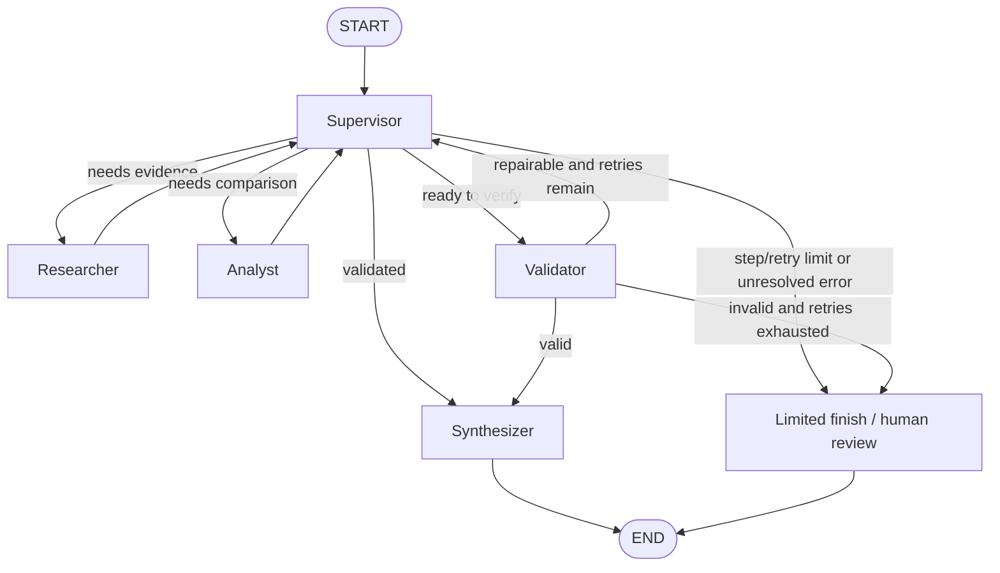

# Architecture Decision Assistant (ADA)

Asistente multiagente para decisiones de arquitectura de software basadas en evidencia, construido con Python, LangGraph, Pydantic y Groq.

## Problema que resuelve

ADA recibe un escenario técnico (por ejemplo, decidir si una API .NET debe ser monolito, monolito modular o microservicios), recupera evidencia de un corpus técnico local, compara alternativas con criterios ponderados y genera una recomendación final trazable. Las afirmaciones basadas en el corpus citan sus fuentes; el análisis numérico se calcula con Python determinístico, no con el LLM.

## Alcance y limitaciones

- Recuperación híbrida local: BM25 + embeddings + Reciprocal Rank Fusion (RRF).
- Corpus técnico curado y versionado en `data/corpus/`.
- Scoring determinístico en Python, validado por un nodo no-LLM.
- Limitación clave: la evidencia disponible está definida por el corpus local. ADA no inventa fuentes; si no hay evidencia, lo reporta.

## Requisitos

- Python 3.12+
- `uv`
- Una clave de Groq para llamadas en vivo (no requerida para los tests)

## Instalación

```bash
uv sync --extra dev --extra retrieval
cp .env.example .env
```

Añade tu `GROQ_API_KEY` a `.env`. Nunca hagas commit de `.env`.

## Arquitectura



### Roles

- **Supervisor**: decide el siguiente nodo con salida estructurada (`RoutingDecision`) validada con Pydantic. No modifica artefactos. Impone límites de pasos (8) y reparaciones (2). Ante fallo del modelo, enruta a `limited_finish` de forma segura.
- **Researcher**: recupera evidencia del corpus con `HybridRetriever` (BM25 + embeddings + RRF) y devuelve un `ResearchArtifact` con fuentes. No inventa fuentes; si no hay evidencia, lo reporta.
- **Analyst**: compara monolito, monolito modular y microservicios con criterios ponderados. Los totales los calcula Python (`calculate_weighted_score`, `rank_alternatives`), nunca el LLM.
- **Validator**: nodo determinístico (no LLM). Valida contratos Pydantic, pesos, rangos de puntajes, referencias a evidencias y coherencia con el scoring calculado. Marca `requires_human_review` cuando se agotan los reintentos.
- **Synthesizer**: genera el informe final a partir de artefactos validados. Si el validador no aprobó, el informe queda como `needs_human_review`, nunca como recomendación definitiva.

## Estructura

```
src/ada/
├── agents/           # Researcher, Analyst, Supervisor, prompts
├── retrieval/        # BM25, vector, RRF, hybrid, corpus, encoder
├── tools/            # scoring determinístico
├── schemas.py        # contratos Pydantic
├── state.py          # estado compartido LangGraph
├── graph.py          # StateGraph y nodos
└── __main__.py       # CLI
data/corpus/          # corpus técnico versionado
tests/unit/           # tests unitarios y del grafo
```

## Ejecución

```bash
# Tests (sin red, sin claves)
uv run pytest

# Lint
uv run ruff check .

# CLI de demostración (requiere GROQ_API_KEY)
uv run python -m ada
uv run python -m ada --request "Decidir arquitectura para una API .NET"
```

## Ejemplo de entrada

> Decidir si una API .NET debe permanecer como monolito, evolucionar a monolito modular o migrar a microservicios. El equipo es pequeño, hay presión por entregar rápido y no se requieren despliegues independientes.

## Ejemplo de salida (representativa)

```
Nodos recorridos: ['researcher', 'analyst', 'validator', 'synthesizer']
Fuentes recuperadas (5):
  - [doc-modular-monolith-01] Modular Monolith: a primer
    Fuente: https://www.kamilgrzybek.com/design/modular-monolith-primer/
Puntuaciones ponderadas:
  - Monolito: 0.640
  - Monolito modular: 0.710
  - Microservicios: 0.560
  Ranking: modular-monolith > monolith > microservices
Validación: aprobada
=== INFORME FINAL ===
Estado: complete
Recomendación: Recomendación: 'Monolito modular' (puntaje ponderado 0.710).
```

## Scoring ponderado y RRF

- **Scoring**: cada alternativa se puntúa de 1 a 5 por criterio. Python calcula `suma(peso × score/5)` con `calculate_weighted_score` y ordena con `rank_alternatives`. Los pesos suman 1 con tolerancia pequeña y Python valida la coherencia.
- **RRF (Reciprocal Rank Fusion)**: BM25 (léxico) y búsqueda vectorial (semántica, `all-MiniLM-L6-v2` local) generan rankings independientes; RRF los fusiona con `1/(k + rank)`, conservando `document_id`, `source` y las estrategias que coincidieron.

## Gestión de errores y revisión humana

- Sin evidencia suficiente: el `ResearchArtifact` lo declara en `evidence_gaps`; no se fabrican fuentes.
- Validación con errores: el supervisor puede reintentar (máximo 2 reparaciones); al agotarse, el informe queda `needs_human_review` o `limited`, con los errores visibles.
- Fallo del LLM o salida inválida: el supervisor usa una ruta segura (`limited_finish`) y el flujo termina controlado, sin bucles.

## Limitaciones

- La evidencia disponible está definida por el corpus local versionado en `data/corpus/`.
- El scoring por defecto es una línea base determinística; el LLM puede proponer puntajes, pero Python valida y calcula los totales.
- No hay interfaz web, base de datos externa ni infraestructura cloud: solo Groq para las llamadas LLM de la demo.

## Principios de diseño

- La evidencia conserva identificadores de fuente y procedencia.
- El scoring numérico lo calcula Python, no el LLM.
- Cada nodo del grafo es dueño solo de sus campos de salida en el estado compartido.
- El supervisor tiene routing explícito y límites de terminación.
- La evidencia faltante se reporta, no se fabrica.
