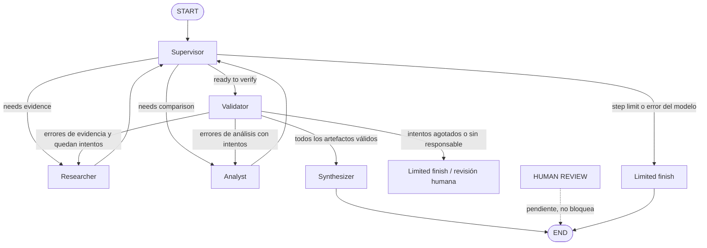

# Architecture Decision Assistant (ADA)

Asistente multiagente para decisiones de arquitectura de software basadas en evidencia, construido con Python, LangGraph, Pydantic y Groq.

## Problema que resuelve

ADA recibe un escenario técnico (por ejemplo, decidir si una API .NET debe ser monolito, monolito modular o microservicios), recupera evidencia de un corpus técnico local, compara alternativas con criterios ponderados y genera una recomendación final trazable. Las afirmaciones basadas en el corpus citan sus fuentes; el análisis numérico se calcula con Python determinístico, no con el LLM.

## Topología jerárquica y responsabilidad de cada nodo



### Responsabilidad de cada nodo

- **Supervisor**: coordina y enruta dinámicamente entre especialistas con salida estructurada (`RoutingDecision`) validada con Pydantic. No investiga ni calcula puntajes. Impone límites globales de pasos (8). Ante fallo del modelo, enruta a `limited_finish` de forma segura.
- **Researcher**: recupera evidencia del corpus con `HybridRetriever` (BM25 + embeddings + RRF) y devuelve un `ResearchArtifact` con fuentes. Si hay errores de validación pendientes, regenera su propio artefacto (reemplazando la versión inválida) y limpia los errores del estado.
- **Analyst**: construye el análisis desde la solicitud del usuario, el perfil del sistema, los criterios y la evidencia recuperada (`derive_scores_from_evidence`). Los totales los calcula Python (`calculate_weighted_score`, `rank_alternatives`), nunca el LLM. Si hay errores de análisis, reintenta con los errores específicos en el estado.
- **Validator**: nodo determinístico (no LLM). Valida contratos Pydantic, pesos, rangos de puntajes, referencias a evidencias y coherencia con el scoring calculado. Clasifica cada error por el especialista responsable (`research_errors` / `analysis_errors`) y entrega los errores específicos en el estado (`validation_errors`).
- **Synthesizer**: genera el informe final solo si el validador aprobó. Si la validación falló, el informe queda como `needs_human_review`, nunca como recomendación definitiva.

## Ciclo de validación y reparación

1. El Supervisor delega en Researcher y Analyst según el estado.
2. El Validator ejecuta validaciones determinísticas (contratos Pydantic, pesos, rangos, referencias, coherencia con scoring) y clasifica cada error por el especialista responsable.
3. Si hay errores corregibles y quedan intentos (`retries < ADA_MAX_RETRIES`), el grafo enruta al especialista responsable con los errores específicos en `validation_errors`; el contador de reintentos se incrementa en Python, nunca por decisión del LLM.
4. El especialista regenera su propio artefacto (reemplazando la versión inválida) y limpia los errores pendientes.
5. Si todos los artefactos son válidos, el Synthesizer produce el informe final.
6. Si se agotan los intentos, el flujo termina con `limited_finish` (resultado seguro, revisión humana pendiente). Nunca sintetiza un informe exitoso con artefactos inválidos.

## AgentState y aislamiento de escritura

`AgentState` (en `src/ada/state.py`) es el estado compartido de LangGraph. Cada nodo es dueño solo de sus campos y devuelve actualizaciones parciales:

- **Supervisor**: `next_agent`, `routing_reason`, `steps`, `task_completed`.
- **Researcher**: `research_artifact`.
- **Analyst**: `analysis_artifact`.
- **Validator**: `validation_result`, `retries`, `validation_errors`.
- **Synthesizer**: `final_report`.

La traza auditable (`contributions`) registra por cada paso: agente, tipo de artefacto, resumen, paso, decisión, motivo, intento y errores relevantes. No guarda secretos ni historiales enormes.

## Recuperación híbrida y trazabilidad

- **BM25** (léxico) + **embeddings** (`all-MiniLM-L6-v2` local) + **RRF (Reciprocal Rank Fusion)** con `1/(k + rank)`.
- Cada evidencia conserva `document_id`, `source_uri`, `excerpt`, `retrieval_method` y `content_hash`.
- Si no hay evidencia, el `ResearchArtifact` lo declara en `evidence_gaps`; no se fabrican fuentes.

## Scoring determinístico y límites del análisis asistido por LLM

- **Scoring**: cada alternativa se puntúa de 1 a 5 por criterio. Python calcula `suma(peso × score/5)` con `calculate_weighted_score` y ordena con `rank_alternatives`. Los pesos suman 1 con tolerancia pequeña y Python valida la coherencia.
- **Derivación de puntajes**: `derive_scores_from_evidence` puntúa por señales del caso de uso (solicitud del usuario + perfil del sistema) contra la evidencia recuperada. Los criterios sin respaldo de evidencia se marcan `is_assumption=True`.
- **Límite del LLM**: el LLM solo coordina el enrutamiento y puede proponer puntajes como propuestas sujetas a validación; nunca calcula totales ni decide la reparación.

## Instalación y configuración

```bash
uv sync --extra dev --extra retrieval
cp .env.example .env
```

Añade tu `GROQ_API_KEY` a `.env`. Nunca hagas commit de `.env`.

Variables de entorno (ver `.env.example`):

- `GROQ_API_KEY`: clave de Groq (requerida solo para la demo LLM en vivo).
- `ADA_LLM_PROVIDER`, `ADA_LLM_MODEL`, `ADA_TEMPERATURE`: proveedor y modelo.
- `ADA_MAX_STEPS`: límite global de pasos (default 8).
- `ADA_MAX_RETRIES`: máximo de rondas de reparación (default 2).
- `ADA_TOP_K`: evidencias a recuperar (default 5).
- `ADA_EMBEDDING_MODEL`: modelo de embeddings local.

## Ejecución

```bash
# Tests (sin red, sin claves)
uv run pytest

# Lint
uv run ruff check .

# CLI de demostración (requiere GROQ_API_KEY)
uv run python -m ada
uv run python -m ada --request "Decidir arquitectura para una API .NET"
```

## Ejemplo de ejecución e interpretación de la traza

```
Nodos recorridos: ['researcher', 'analyst', 'validator', 'synthesizer']
Fuentes recuperadas (5):
  - [doc-modular-monolith-01] Modular Monolith: a primer
    Fuente: https://www.kamilgrzybek.com/design/modular-monolith-primer/
Puntuaciones ponderadas:
  - Monolito: 0.640
  - Monolito modular: 0.710
  - Microservicios: 0.560
  Ranking: modular-monolith > monolith > microservices
Validación: aprobada
=== INFORME FINAL ===
Estado: complete
Recomendación: Recomendación: 'Monolito modular' (puntaje ponderado 0.710).
```

Interpretación de la traza (`contributions`): cada registro incluye `agent`, `artifact_type`, `summary`, `step`, `decision`, `reason`, `attempt` y `errors`. Un `attempt > 0` indica una ronda de reparación tras validación; los `errors` listados son los errores concretos que el especialista corrigió.

## Gestión de errores y revisión humana

- Sin evidencia suficiente: el `ResearchArtifact` lo declara en `evidence_gaps`; no se fabrican fuentes.
- Validación con errores: el grafo enruta al especialista responsable (máximo `ADA_MAX_RETRIES` reparaciones); al agotarse, el informe queda `limited` o `needs_human_review`, con los errores visibles.
- Fallo del LLM o salida inválida: el supervisor usa una ruta segura (`limited_finish`) y el flujo termina controlado, sin bucles.

**Qué significa "requiere revisión humana"**: el sistema no pudo completar una decisión validada y no emite recomendación definitiva. No bloquea el programa ni finge una revisión real: deja el resultado marcado (`needs_human_review` o `limited`) con los errores visibles para que una persona los revise manualmente.

## Limitaciones

- La evidencia disponible está definida por el corpus local versionado en `data/corpus/`.
- El scoring por defecto es una línea base determinística basada en señales de palabras clave; no reemplaza el juicio experto.
- No hay interfaz web, base de datos externa ni infraestructura cloud: solo Groq para las llamadas LLM de la demo.

## Principios de diseño

- La evidencia conserva identificadores de fuente y procedencia.
- El scoring numérico lo calcula Python, no el LLM.
- Cada nodo del grafo es dueño solo de sus campos de salida en el estado compartido.
- El supervisor tiene routing explícito y límites de terminación.
- La decisión post-validación es determinística, no depende del modelo.
- La evidencia faltante se reporta, no se fabrica.
